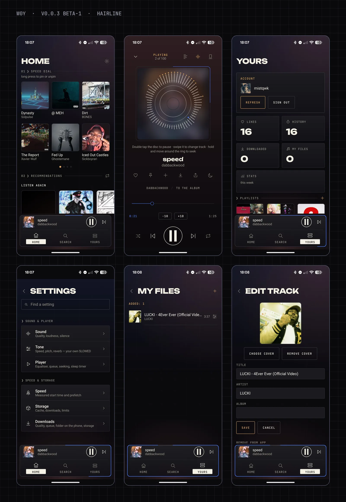

<p align="center">
  
  
  
</p>

# w0y

**Fast, adjustable, and yours.** An open client for YouTube Music: it starts
tracks quickly, has a lot of settings, shows no ads of its own and sends no
telemetry anywhere. You can sign in to your own account to get your library,
playlists and likes.

Part of the [TexFi](https://texfi-hub.vercel.app) family. The default look
is **Hairline**: thin lines, sharp corners, one hero per screen, a floating
bottom dock. The older Pixel and Smooth looks are still in Settings → Look.

## Screenshots

<!-- screenshots:start -->
[](docs/screenshots/w0y-screens.png)
<!-- screenshots:end -->

## Features

- **Search and playback** — tracks, albums, artists and videos; artist and
  album pages; background playback with a media notification, queue you can
  edit (reorder, remove, play next), repeat, shuffle, sleep timer.
- **Quick start** — the next track is prefetched, stream URLs are cached, and
  the time from tap to first sound is measured and shown, so "fast" is a
  number you can check.
- **Your account** — pick one of the Google accounts on the phone and confirm
  on Google's page, or paste a cookie by hand. Playlists, likes and
  subscriptions are synchronised both ways.
- **Lyrics** as a full page, line by line in time with the voice, with
  translation and an adjustable delay. Searched by artist and title in
  [LRCLIB](https://lrclib.net) first, then NetEase, lyrics.ovh and Genius
  (can be turned off).
- **Your own files** — add mp3, wav and other audio from the phone, edit the
  title, artist, album and cover inside the app. They go into playlists and
  speed dial, and get recommendations like any track. If a file stops
  opening, the same track from the catalogue plays instead.
- **Video** — for tracks that are real YouTube videos you can switch the cover
  to the video; the sound keeps playing from the same stream.
- **Your own sound per track** — speed, pitch and reverb (SLOWED, SPED UP)
  applied to the original file and remembered for that track only.
- **Downloads** — tracks, albums, playlists; a "Wi-Fi only" limit; a button
  that copies them into `Music/w0y music`.
- **Search** with YouTube's suggestions and a history you can clear.
- **Speed dial, stats and a widget** — what you play most on the home screen,
  listening stats computed on the device, a home screen widget.
- **Clean mode** — swaps in the official clean version when one exists; tracks
  marked "E" can be hidden or skipped.
- **Settings** — eleven sections with a search across all of them: quality,
  normalisation, queue behaviour, seek step, themes and colour schemes, your
  own accent colour, settings export and import.
- **Languages** — Russian, English, Ukrainian, Polish.
- **Windows and Linux desktop version** — the same ideas on Compose Desktop
  in the Hairline look, sized for a mouse and a keyboard: a side bar, a wide
  player bar, a big player with a disc, eight settings tabs, hotkeys, a mini
  player, a tray icon. Sound is played by libmpv built into the app. See
  [docs/DESKTOP_PARITY.md](docs/DESKTOP_PARITY.md) for what the desktop has and what it does not yet.

## Privacy

**What leaves the app:** YouTube (search, music, sign-in) and GitHub (the
update check, which you can turn off). Everything else stays on your device.
The full list is in [docs/PRIVACY.md](docs/PRIVACY.md).

- Library, history, settings, downloads and stats are stored **on the device**
  (Windows: `%APPDATA%\w0y`; Linux: `~/.local/share/w0y`). Nothing is uploaded to any
  server of this project; there is none, and there is no analytics or crash
  reporting.
- Requests the app makes, and why:
  - `music.youtube.com` — search, your library, stream links. If you sign in,
    the session cookie is sent there like a web browser would.
  - `accounts.google.com` — only the sign-in page.
  - `lrclib.net` — lyrics (artist, title and duration of the track). If it
    has none and "Search lyrics everywhere" is on: `music.163.com`,
    `api.lyrics.ovh` and `genius.com` get the artist and title.
  - `translate.googleapis.com` — only if you turn lyrics translation on; the
    lyric lines are sent for translation.
  - Public Piped servers — a fallback source of audio when YouTube does not
    give a stream link; the video id is sent.
- The sign-in cookie stays on the device. Treat it like a password.

## Install

**Android 8.0 (API 26) or newer.**

1. Download [`TexFi-w0y-android.apk`](https://github.com/texfi-w0y/texfi-w0y/releases/download/v0.0.4-beta-2/TexFi-w0y-android.apk)
   from the [release page](https://github.com/texfi-w0y/texfi-w0y/releases/tag/v0.0.4-beta-2)
   and open it. Checksums are in `SHA256SUMS.txt` next to it.
2. Or add `https://github.com/texfi-w0y/texfi-w0y` to
   [Obtainium](https://github.com/ImranR98/Obtainium).

Updates install over the top as long as they come signed with the project key.
The app also checks this page itself when it starts and offers the update
(Update / Later); it stays in Settings → App. You can turn the check off there.

**Windows 10/11 (x64):** download `w0y-windows-x64-setup.exe` (or the portable
`w0y-windows-x64-portable.zip`) from the release page. The installer is not
signed with a paid certificate, so SmartScreen may warn you: click *More info →
Run anyway* after checking the hash in `SHA256SUMS-desktop.txt`. Details in
[docs/WINDOWS_INSTALL.md](docs/WINDOWS_INSTALL.md).

**Linux (x86_64):** download `w0y-linux-x86_64.AppImage` (libmpv inside), make it
executable and run it; or unpack `w0y-linux-x86_64.tar.gz` and run `./install.sh`
(it needs `libmpv`/`mpv` from your distribution: `sudo pacman -S mpv` or
`sudo apt install libmpv2`). Works on Wayland and X11. The interface is in
Russian, English, Ukrainian and Polish.

### Desktop hotkeys

`Space` play/pause · `←`/`→` seek · `Ctrl+←`/`Ctrl+→` previous/next · `↑`/`↓` volume ·
`M` mute · `/` or `Ctrl+K` search · `1`–`5` tabs · `Q` player · `Y` lyrics ·
`B` Stand mode · `Ctrl+M` mini player · `F11` full screen · `Esc` back · `?` the full
list (rebind in Settings → App). Right click on a track opens its menu; `Ctrl`/`Shift`
select several; double click plays. The media keys of the keyboard work too.

## Build from source

You need JDK 21 and the Android SDK (compileSdk 37). Put the SDK path into
`local.properties` (`sdk.dir=...`, the file is git-ignored).

```bash
./gradlew testDebugUnitTest assembleDebug   # Android debug APK
```

Desktop version (needs `libmpv`/`mpv` on Linux; Windows builds are made by CI):

```bash
cd desktop && ./install.sh                  # builds and installs for your user (Linux)
cd desktop && ./gradlew test run            # tests / run from source
```

The version number lives in one place, `version.properties`, for all platforms.

Some Android tests hit the real YouTube because only a live request catches a
change in its responses. They are skipped in CI; set `W0Y_LIVE_TESTS=1` to run
them there. Release APKs are built by GitHub Actions on a `v*` tag; the
signing key is not in the repository (see [docs/RELEASING.md](docs/RELEASING.md)).

## Report a problem

Open an [issue](https://github.com/texfi-w0y/texfi-w0y/issues/new/choose) and say
what you did, what you expected and what happened. Add the app version
(Settings → About) and your Android version. The release build writes no log of its own, but the system log still shows
crashes and errors. With the phone connected and w0y running:

```bash
adb logcat -d --pid=$(adb shell pidof com.texfi.w0y) > w0y-log.txt
```

Before posting a log, remove anything personal from it.

## Licence and third-party parts

w0y is licensed under [AGPL-3.0](LICENSE).

| Component | Licence |
| --- | --- |
| [InnerTubeX](https://github.com/MetrolistGroup/innertubex), access to YouTube Music | GPL-3.0 (copy in [licenses/](licenses/GPL-3.0-innertubex.txt)); GPLv3 §13 allows combining with AGPLv3 |
| Jetpack Compose, Material 3, AndroidX (Room, DataStore, Navigation, Media3, Core) | Apache-2.0 |
| Hilt / Dagger | Apache-2.0 |
| Ktor, kotlinx.serialization, Kotlin | Apache-2.0 |
| OkHttp | Apache-2.0 |
| Coil | Apache-2.0 |
| Timber | Apache-2.0 |
| [Backdrop](https://github.com/Kyant0/AndroidLiquidGlass), liquid glass of the bottom bars | Apache-2.0 |
| [jump3r](https://github.com/Sciss/jump3r) (LAME in Java), MP3 export | LGPL-2.1 |
| Press Start 2P font | OFL ([licenses/](licenses/OFL-PressStart2P.txt)) |
| Unbounded font | OFL ([licenses/](licenses/OFL-Unbounded.txt)) |
| JetBrains Mono font | OFL ([licenses/](licenses/OFL-JetBrainsMono.txt)) |
| Linux version: Compose Multiplatform, dbus-java (LGPL/MIT), mpv (GPL/LGPL, run as a separate program) | see each project |

[Metrolist](https://github.com/MetrolistGroup/Metrolist) (GPL-3.0) was a
reference for the feature set; its code was not copied.

## Disclaimer

w0y is an independent project. It is not affiliated with, endorsed by or
connected to YouTube or Google. "YouTube Music" is used only to describe what
the app is compatible with. You are responsible for following the terms of
the services you use it with.

---

The code comments are in Russian: this is a personal project and they are
written in the author's own voice. The documentation and the release notes
are in English, the interface is in four languages.
